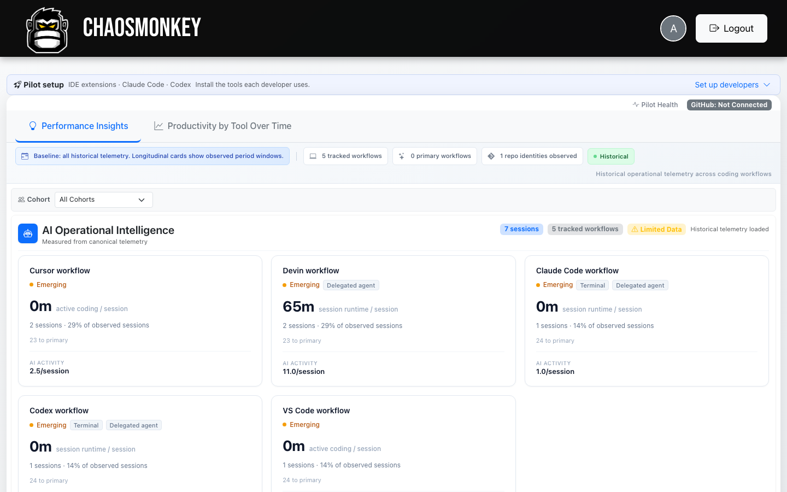
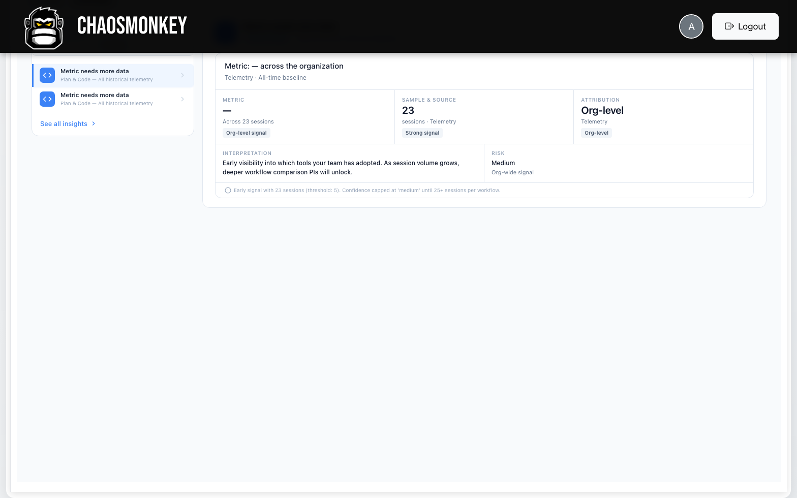
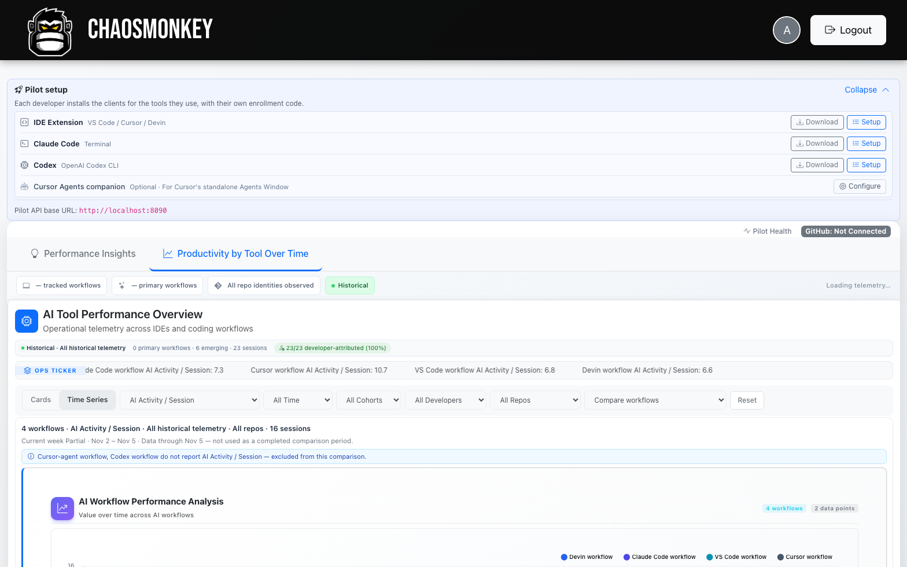
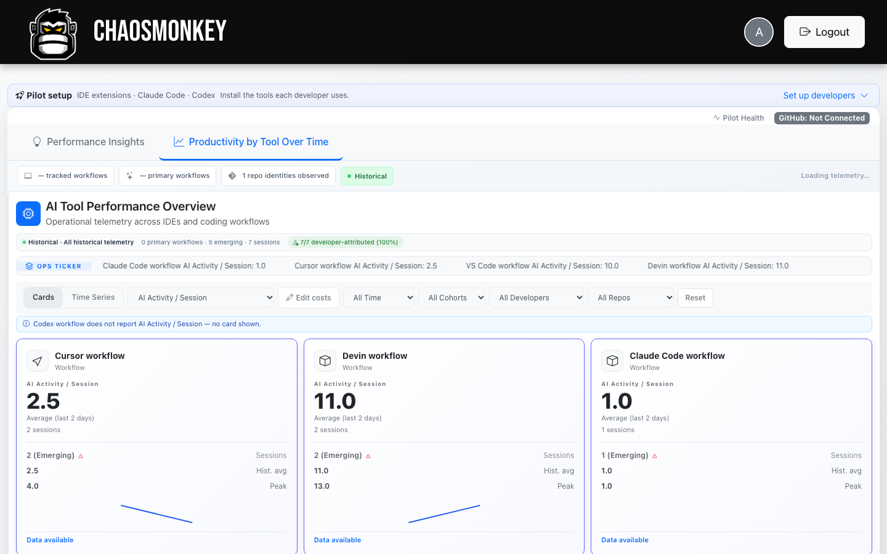
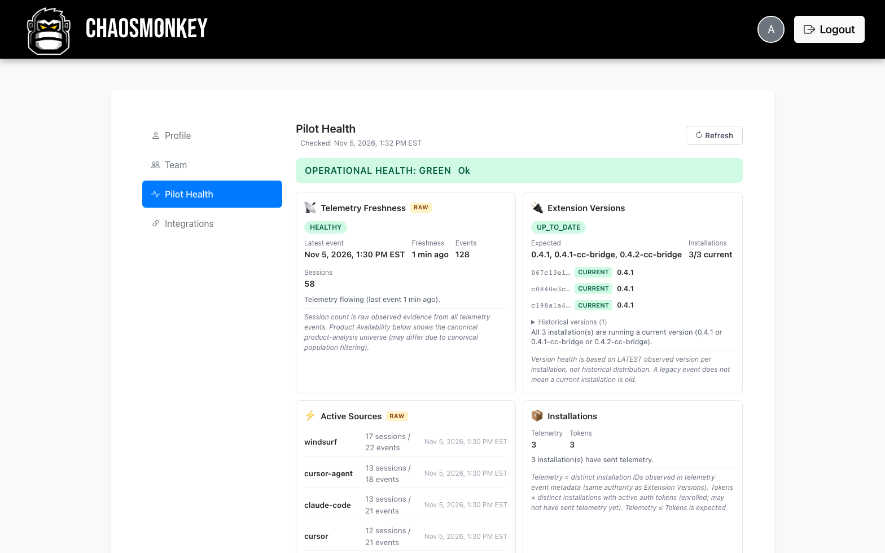
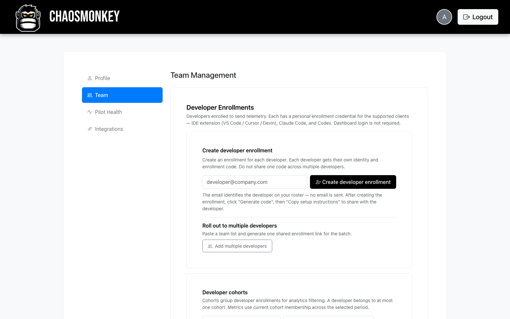

# ChaosMonkey

**Connect AI coding activity to engineering outcomes.**

ChaosMonkey ingests activity from the AI coding tools your team already uses —
VS Code, Cursor, Claude Code, Codex CLI, Cursor Agents — and turns it into
session analytics, per-tool workflow breakdowns, configured spend estimates,
and evidence-gated insights. Session telemetry works standalone; correlating
sessions with pull requests, reviews, and deployments requires the optional
GitHub integration. It was built and operated as a hosted product with real
engineering teams and is now open source so anyone can self-host, inspect,
and extend it.

> **We're open.** `v0.1.3` — Community Preview — is available now under
> Apache-2.0.

**[Quick start](#quick-start-docker) ·
[Screenshots](#what-it-looks-like) ·
[Integrations](#supported-integrations) ·
[Extending](#extending-chaosmonkey) ·
[Architecture](#architecture) ·
[Contributing](CONTRIBUTING.md) ·
[Security](SECURITY.md) ·
[Privacy](PRIVACY.md)**

## Quick start (Docker)

The recommended install is a single all-in-one container — nginx, PHP-FPM,
Laravel, and a persistent SQLite database:

```bash
docker run -d --name chaosmonkey \
  -p 127.0.0.1:8080:80 \
  -v chaosmonkey-data:/data \
  ghcr.io/chaosmonkey-dev/chaosmonkey:0.1.3
```

Then open <http://localhost:8080> and create your first administrator account:

```bash
docker exec -it chaosmonkey \
  php /var/www/backend/artisan chaosmonkey:create-admin you@example.com
```

From there: create an invite, issue a connect code, and install a client —
the full org walkthrough is [docs/onboarding.md](docs/onboarding.md), and
per-tool setup is [docs/integrations.md](docs/integrations.md). Source builds
and Docker Compose are documented in
[docs/installation.md](docs/installation.md).

All application data lives in the `/data` volume — nothing leaves your
infrastructure. GitHub integration is optional; telemetry works without it.

## What it looks like

*All screenshots below render synthetic demo data — no customer information.*

**AI Operational Intelligence** — the top-level view: per-workflow cards
across 226 demo sessions showing session runtime, AI activity, adoption
share, and instrumentation coverage per tracked tool.



**Performance Insights** — the evidence-gated engine in action: a qualified
finding ("Cursor averages 37.8 more active-coding min/session than VS Code")
expanded with session counts on both sides of the comparison and its
evidence basis. Findings the data can't support surface as honest
"collecting evidence" cards instead (see the gallery).



**Productivity by Tool — time series** — per-workflow metrics plotted over
six weeks, with metric, period, cohort, developer, repository, and
workflow-comparison filters. The cost layer is labeled "Configured
estimate · Not billing data."



**Productivity by Tool — cards** — the second PBT mode: per-workflow
longitudinal cards with historical averages, peaks, sparklines, and an ops
ticker across all tracked workflows.



**Pilot Health** — the administrator's operational view: telemetry freshness,
extension-version distribution across installations, active sources, and
installation counts — the screen watched during rollout.



**Team Management** — developer enrollments: each developer gets a personal
enrollment credential for the supported clients (no dashboard login required
to send telemetry), with bulk rollout and cohort grouping on the same page.



More views — the evidence-gated insights state, client setup, enrollment
roster, GitHub setup, and sign-in — in the
[product gallery](docs/product-gallery.md).

## What it does

- **Unified session telemetry** — activity from supported AI coding tools is
  normalized into canonical sessions with per-tool attribution.
- **Productivity by tool** — compare throughput, edit patterns, and session
  characteristics across Cursor, Claude Code, Codex, and more.
- **AI spend estimation** — configured monthly spend per tool, surfaced next to
  observed usage. *These are configured estimates, not billing data.*
- **Performance Insights** — an evidence-gated insights engine that only
  surfaces findings backed by observed telemetry.
- **GitHub delivery evidence** *(optional)* — connect GitHub OAuth or a GitHub
  App to correlate sessions with pull requests, reviews, and deployments.
- **Organizations** — multi-tenant orgs with invite/connect-code enrollment;
  each install is its own authority.

## Extending ChaosMonkey

ChaosMonkey is designed to be customized, not just deployed. Each surface
below ships in `v0.1.3` and has a dedicated guide:

- **Performance Insights** — write or tune insight generators and their
  evidence rules:
  [docs/extending/performance-insights.md](docs/extending/performance-insights.md)
- **Productivity by Tool** — add metrics and views across the telemetry and
  delivery planes:
  [docs/extending/productivity-by-tool.md](docs/extending/productivity-by-tool.md)
- **New coding-tool integrations** — the four packaged clients in
  `extensions/` are worked examples; the ingest contract and client
  architecture live in [docs/integrations.md](docs/integrations.md) and
  [docs/reference/](docs/reference/)
- **Telemetry & identity model** — canonical session/tool taxonomy and the
  server-authoritative ingest boundary: [docs/architecture.md](docs/architecture.md)
- **GitHub delivery evidence** — optional OAuth or GitHub App correlation of
  sessions with PRs, reviews, and deployments:
  [docs/integrations.md](docs/integrations.md)
- **Self-hosting** — authentication, persistence, backup, and upgrades:
  [docs/installation.md](docs/installation.md),
  [docs/operations.md](docs/operations.md)

The reasoning behind the data, attribution, and evidence contracts is recorded
in [docs/decisions/](docs/decisions/) — seven architecture decision records
worth reading before touching analytics code. [docs/README.md](docs/README.md)
maps every audience to its authoritative doc, and
[CONTRIBUTING.md](CONTRIBUTING.md) covers local development and running the
full backend and frontend test suites.

## Supported integrations

| Tool | Client | Package version | Status |
|---|---|---|---|
| VS Code / Cursor IDE | `extensions/chaosmonkey-telemetry` (VSIX) | 0.4.1 | Packaged artifact verified; authenticated ingest tested |
| Windsurf / Devin Desktop IDE | same VSIX — VS Code forks | 0.4.1 | Real-binary install verified; source classification tested |
| Claude Code | `extensions/claude-code-bridge` | 0.4.2-cc-bridge | Verified via packaged install → hook invocation → ingest\* |
| Cursor Agents Window | `extensions/cursor-agent-bridge` | 0.4.2-cursor-bridge | Verified via packaged install → hook invocation → ingest\* |
| Codex CLI | `extensions/codex-bridge` | 0.4.1-codex-bridge | Verified via packaged install → hook invocation → ingest\*; requires hook-trust in Codex |
| GitHub OAuth | backend | — | Optional; config + callback tested |
| GitHub App | backend | — | Optional; webhook signature handling tested |

\* Verification used the packaged client artifacts with hook events invoked
against a live local instance. Sessions from the vendor tools themselves were
not independently exercised as part of release testing.

Packaged client artifacts are served by the backend itself
(`/api/*/download/latest`), so installs always get the version matching their
server. Cursor's standalone Agents Window is observed via a dedicated bridge —
it is distinct from both the IDE extension and the Claude Code bridge, and its
sessions are attributed as `cursor-agent`.

See [docs/integrations.md](docs/integrations.md) for per-tool setup,
limitations, and explicitly unsupported tools, and
[docs/release-manifest.md](docs/release-manifest.md) for the checksum-pinned
artifact manifest of the current release.

## Architecture

```
extensions/  VS Code/Cursor extension + Claude Code, Codex, Cursor-agent bridges
frontend/    Vue 3 + TypeScript + Vite + Pinia + Tailwind
backend/     Laravel 12 (PHP 8.2+), SQLite, token + session auth
docker/      nginx config + container entrypoint
docs/        install, integrations, operations, contributor docs
tools/demo/  synthetic telemetry generator for demos and testing
```

The all-in-one image runs: nginx (SPA + `/api` proxy) → PHP-FPM → Laravel →
SQLite on `/data`. There are no queues, workers, or external services — GitHub
and Atlassian integrations are optional.

## Development

```bash
# Backend (http://localhost:8010)
cd backend && composer install && cp .env.example .env
php artisan key:generate && php artisan migrate
php artisan serve --port=8010

# Frontend (http://localhost:5174)
cd frontend && npm install && npm run dev
```

Or run `dev/up.sh` to start both. See [CONTRIBUTING.md](CONTRIBUTING.md).

## Privacy

ChaosMonkey collects **aggregate activity telemetry** — event counts, durations,
tool and session metadata — designed to avoid source code or file contents.
Self-hosting means your data stays on your infrastructure. See
[PRIVACY.md](PRIVACY.md) for exactly what each client sends.

## Why ChaosMonkey?

Yes, we know about Netflix's Chaos Monkey.

The original Chaos Monkey made infrastructure failures visible by
deliberately creating them. Ours is concerned with a different kind of
chaos: what happens when AI coding tools enter the software development
lifecycle.

Different monkeys. Different chaos.

*ChaosMonkey is an independent project. It is not affiliated with,
endorsed by, or connected to Netflix.*

## License

[Apache-2.0](LICENSE) — contributions accepted under the Developer Certificate
of Origin (see [CONTRIBUTING.md](CONTRIBUTING.md)).

ChaosMonkey is a trademark of its maintainers; the Apache-2.0 grant covers
copyright and patent rights, not trademark use. See LICENSE for details.
