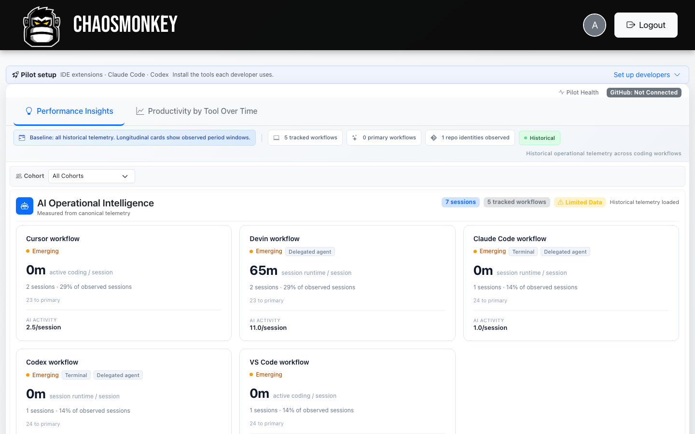
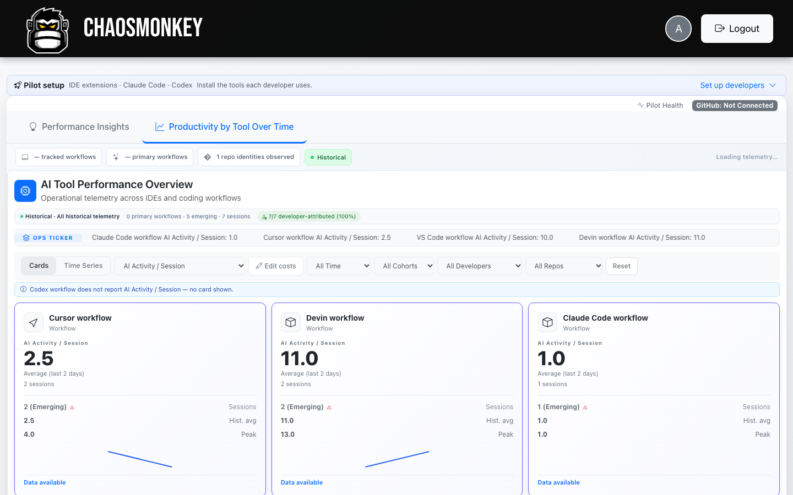

# ChaosMonkey

**Telemetry and analytics for AI-assisted engineering teams.**

ChaosMonkey ingests activity from the AI coding tools your team already uses —
VS Code, Cursor, Claude Code, Codex CLI, Cursor Agents — and turns it into
session analytics, productivity-by-tool breakdowns, AI-spend estimates, and
performance insights. It was built and operated as a hosted product with real
engineering teams and is now open source so anyone can self-host, inspect, and
extend it.

## Quick start (Docker)

The recommended install is a single all-in-one container — nginx, PHP-FPM,
Laravel, and a persistent SQLite database:

```bash
docker run -d --name chaosmonkey \
  -p 8080:80 \
  -v chaosmonkey-data:/data \
  ghcr.io/chaosmonkey-dev/chaosmonkey:0.1.0
```

Then open <http://localhost:8080> and create your first administrator account:

```bash
docker exec -it chaosmonkey \
  php /var/www/backend/artisan chaosmonkey:create-admin you@example.com
```

From there: create an invite, issue a connect code, and install a client
(see [integrations](#supported-integrations)). Source builds and Docker
Compose are documented in [docs/installation.md](docs/installation.md).

All application data lives in the `/data` volume — nothing leaves your
infrastructure. GitHub integration is optional; telemetry works without it.

## What it looks like

*AI Operational Intelligence — five tracked workflows from real sessions
(simulated demo data).*



*Productivity by tool — per-workflow AI activity and session metrics
(simulated demo data).*



## What it does

- **Unified session telemetry** — activity from supported AI coding tools is
  normalized into canonical sessions with per-tool attribution.
- **Productivity by tool** — compare throughput, edit patterns, and session
  characteristics across Cursor, Claude Code, Codex, and more.
- **AI spend estimation** — configured monthly spend per tool, surfaced next to
  observed usage. *These are configured estimates, not billing data.*
- **Performance Insights** — an evidence-gated insights engine that only
  surfaces findings backed by observed telemetry.
- **GitHub delivery evidence** *(optional)* — connect GitHub OAuth or a GitHub
  App to correlate sessions with pull requests, reviews, and deployments.
- **Organizations** — multi-tenant orgs with invite/connect-code enrollment;
  each install is its own authority.

## Supported integrations

| Tool | Client | Package version | Status |
|---|---|---|---|
| VS Code / Cursor IDE | `extensions/chaosmonkey-telemetry` (VSIX) | 0.4.1 | Package-verified; production-observed pre-release |
| Claude Code | `extensions/claude-code-bridge` | 0.4.2-cc-bridge | End-to-end verified (install → hooks → ingest) |
| Cursor Agents Window | `extensions/cursor-agent-bridge` | 0.4.2-cursor-bridge | End-to-end verified (install → hooks → ingest) |
| Codex CLI | `extensions/codex-bridge` | 0.4.1-codex-bridge | End-to-end verified (install → hooks → ingest); requires hook-trust in Codex |
| GitHub OAuth | backend | — | Optional; config + callback tested |
| GitHub App | backend | — | Optional; webhook signature handling tested |

Packaged client artifacts are served by the backend itself
(`/api/*/download/latest`), so installs always get the version matching their
server. Cursor's standalone Agents Window is observed via a dedicated bridge —
it is distinct from both the IDE extension and the Claude Code bridge, and its
sessions are attributed as `cursor-agent`.

See [docs/integrations.md](docs/integrations.md) for per-tool setup,
limitations, and explicitly unsupported tools, and
[docs/release-manifest.md](docs/release-manifest.md) for the checksum-pinned
artifact manifest of the current release.

## Architecture

```
extensions/  VS Code/Cursor extension + Claude Code, Codex, Cursor-agent bridges
frontend/    Vue 3 + TypeScript + Vite + Pinia + Tailwind
backend/     Laravel 12 (PHP 8.2+), SQLite, token + session auth
docker/      nginx config + container entrypoint
docs/        install, integrations, operations, contributor docs
tools/demo/  synthetic telemetry generator for demos and testing
```

The all-in-one image runs: nginx (SPA + `/api` proxy) → PHP-FPM → Laravel →
SQLite on `/data`. There are no queues, workers, or external services — GitHub
and Atlassian integrations are optional.

## Development

```bash
# Backend (http://localhost:8010)
cd backend && composer install && cp .env.example .env
php artisan key:generate && php artisan migrate
php artisan serve --port=8010

# Frontend (http://localhost:5174)
cd frontend && npm install && npm run dev
```

Or run `dev/up.sh` to start both. See [CONTRIBUTING.md](CONTRIBUTING.md).

## Privacy

ChaosMonkey collects **aggregate activity telemetry** — event counts, durations,
tool and session metadata — designed to avoid source code or file contents.
Self-hosting means your data stays on your infrastructure. See
[PRIVACY.md](PRIVACY.md) for exactly what each client sends.

## License

[Apache-2.0](LICENSE) — contributions accepted under the Developer Certificate
of Origin (see [CONTRIBUTING.md](CONTRIBUTING.md)).

ChaosMonkey is a trademark of its maintainers; the Apache-2.0 grant covers
copyright and patent rights, not trademark use. See LICENSE for details.
