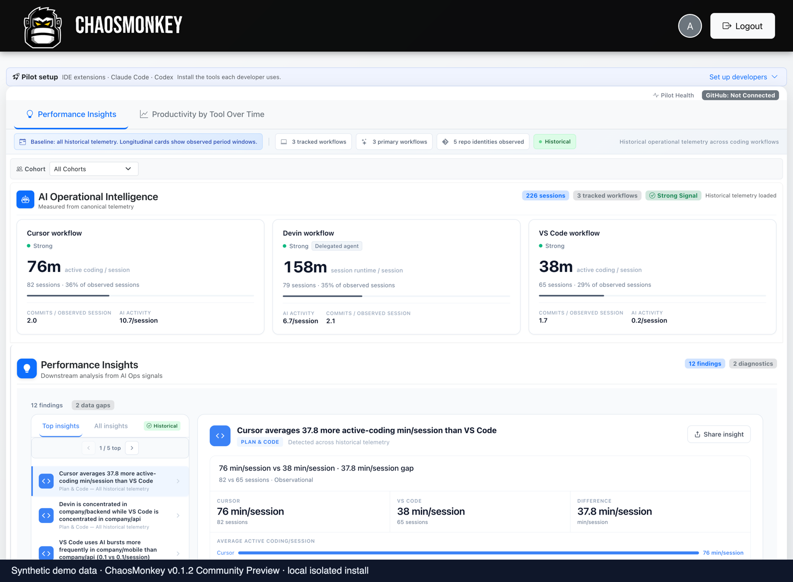
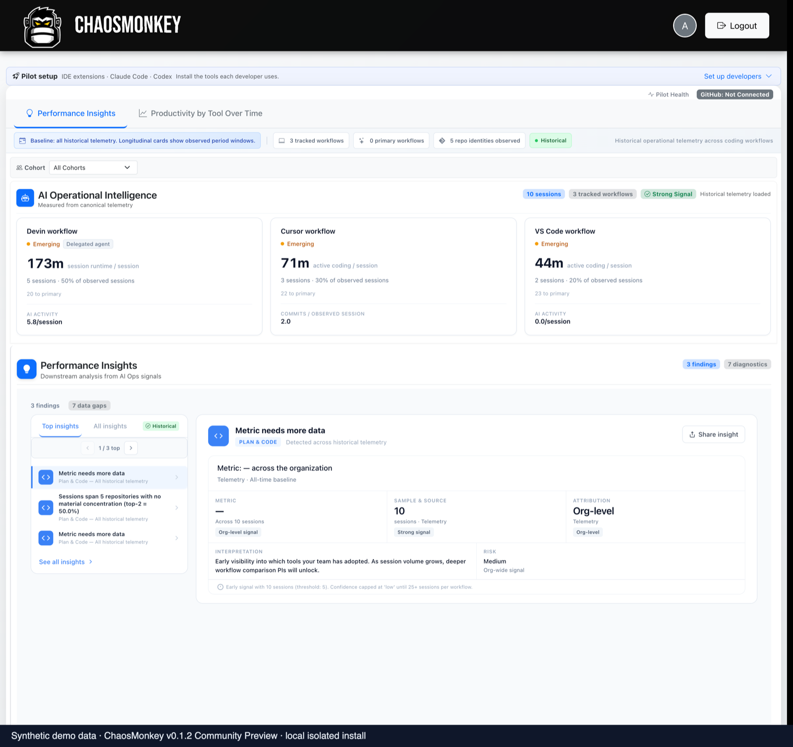
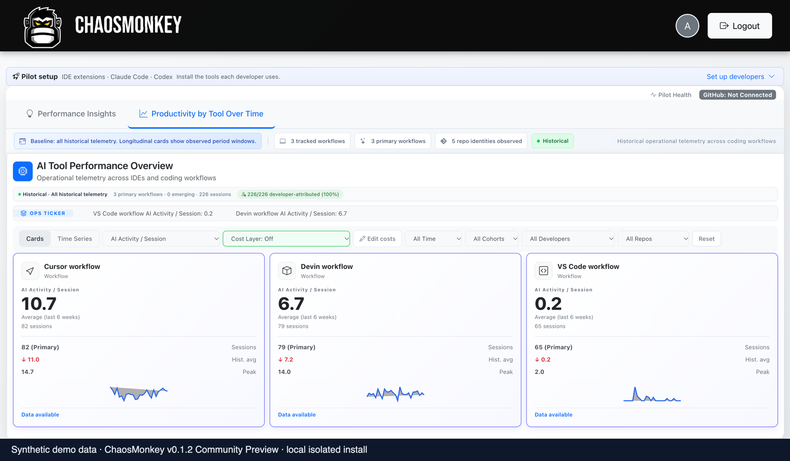

# Product gallery

Screenshots captured from a real `v0.1.2` all-in-one container running
locally in isolation. Every image shows **synthetic demo data only** — each
screenshot carries a "Synthetic demo data" label. No customer or production
telemetry appears anywhere in this gallery.

The demo dataset was ingested through the normal authenticated telemetry
API as timestamped sessions spread across six simulated weeks (226 canonical
sessions across three enrolled developer identities and three tracked
workflows). It passes the same validation, enrichment, and evidence rules as
ordinary telemetry.

Where a feature depends on configuration that was intentionally left
unconfigured (GitHub integration, billing), the screenshot shows the real
unconfigured state — we do not fake populated screens.

## Analytics

### AI Operational Intelligence

Per-workflow session analytics across every tracked tool — session runtime,
AI activity per session, adoption share, and instrumented coverage. Each
card is attributed to a distinct workflow. This view shows the populated
state across 226 demo sessions, with the Performance Insights engine's
qualified output directly below it.

### Productivity by tool — time-series analytics

Historical workflow metrics rendered as real chart lines across a six-week
window. The Time Series tab plots per-workflow values over time with metric,
period, cohort, developer, repository, and workflow-comparison filters. The
cost layer reads configured per-seat spend (labeled "Configured estimate ·
Not billing data"), and partial weeks are flagged rather than silently
counted as completed periods.

### Performance Insights

Performance Insights only fires on sufficient evidence, and the engine says
so when it doesn't have enough. Both states below are real engine output —
nothing is hardcoded or mocked.

**Qualified findings** — with 226 sessions across three workflows, the
engine produces attributed findings, ranks them, and labels each with its
evidence basis ("Observational", session counts on both sides of the
comparison).

**Evidence-gated state** — at low session volume the same engine shows
"collecting evidence" cards that report the sample size, the applicable
threshold ("threshold: 5"), and the confidence cap until 25+ sessions per
workflow. Findings are honest early signals, not fabricated maturity.

### Productivity by tool — summary cards

The longitudinal card view of the same data: per-workflow AI activity with
historical averages, peaks, sparklines, and an ops ticker across all tracked
workflows.

## Team setup and enrollment

### Client setup

The "Pilot setup" panel lists every supported client with download and
setup actions — IDE extension (VS Code / Cursor / Devin), Claude Code,
Codex, and the Cursor Agents companion.

### Developer enrollments

Each developer gets a personal enrollment credential for the supported
clients — no dashboard login is required to send telemetry.

### Roster and dashboard users

Enrolled developers show connection status and installation counts; cohort
assignment and dashboard-user invites live on the same page.

## Operations

### Pilot Health

Operational health for the install: telemetry freshness, extension-version
distribution across installations, active sources, and token/installation
counts. This is the screen an administrator watches during rollout.

### GitHub integration — real unconfigured state

The GitHub Engineering Data card, shown unconfigured — the actual state of
a fresh install. Connecting GitHub enables optional delivery evidence
(repositories, PRs, commits, deployments); identity-only logins produce
zero engineering evidence.

## Access

### Sign in

Admin and member sign-in. Accounts are created by an organization
administrator — there is no self-serve signup.

