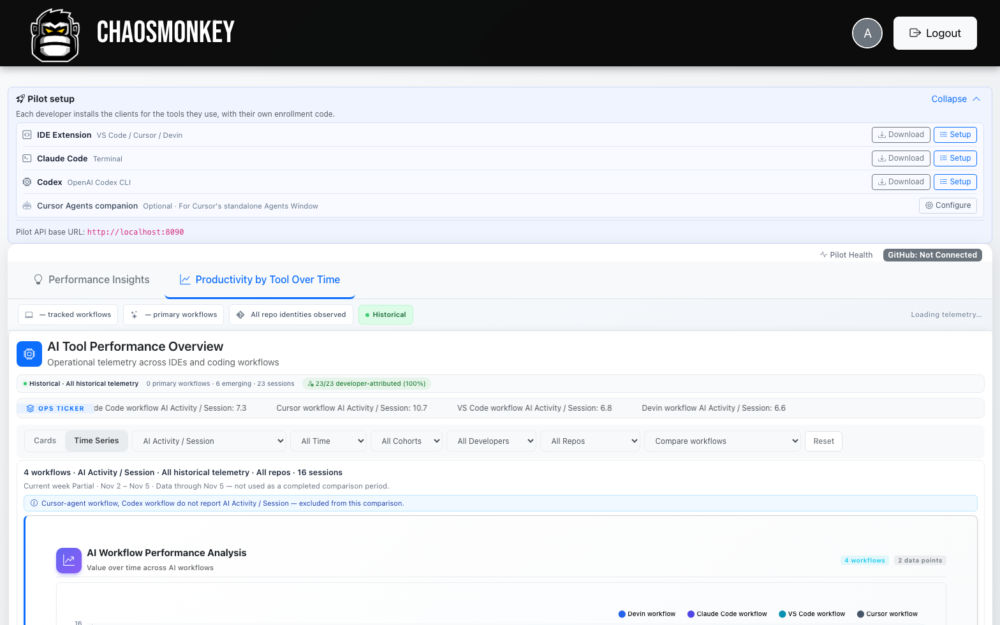
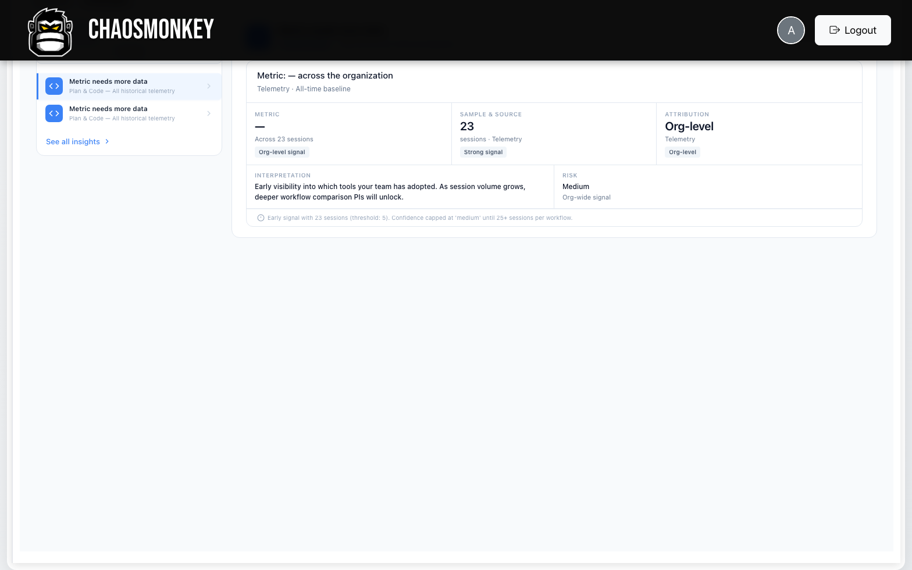
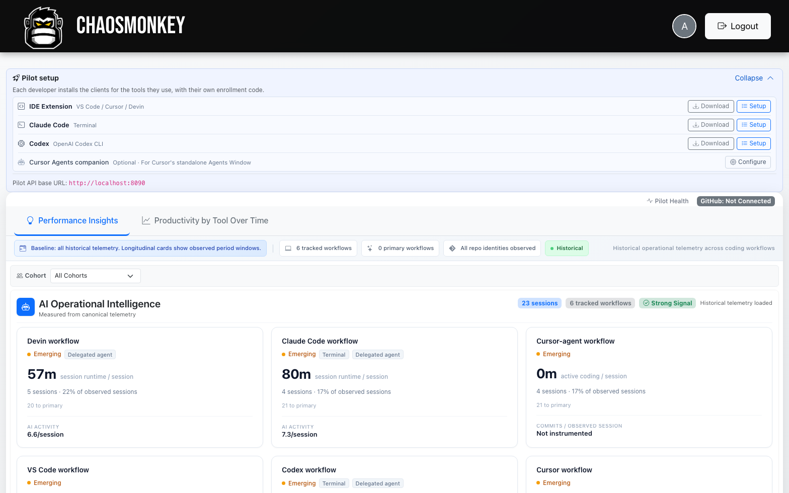
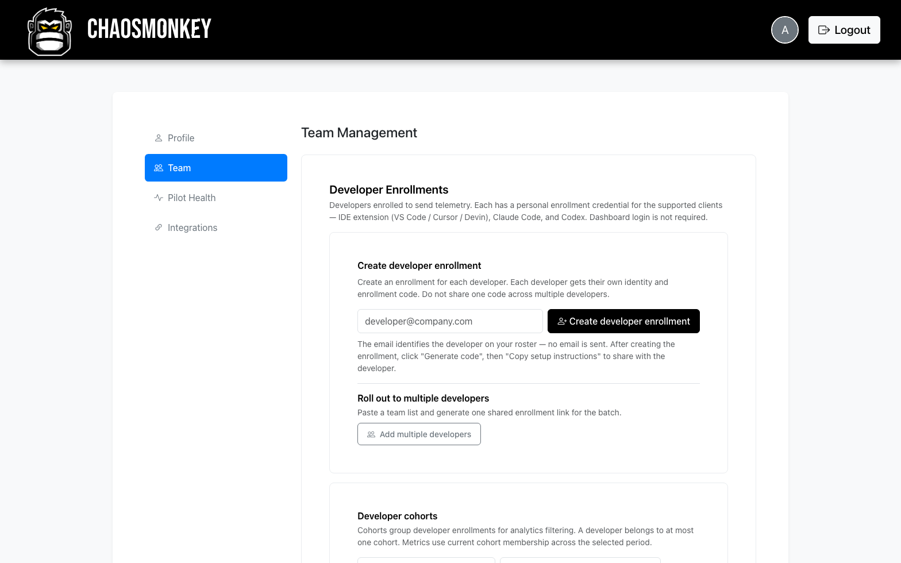
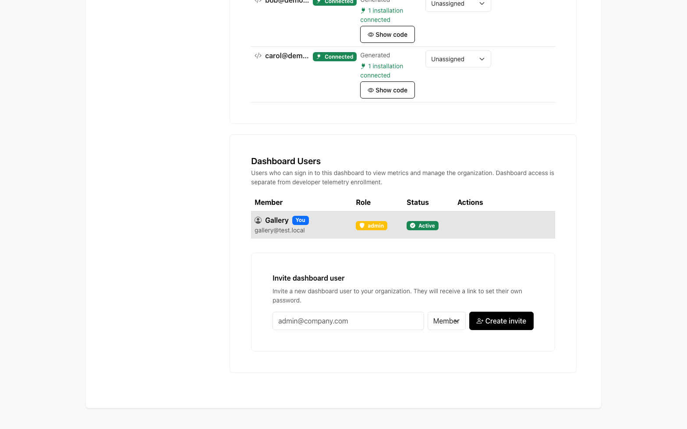
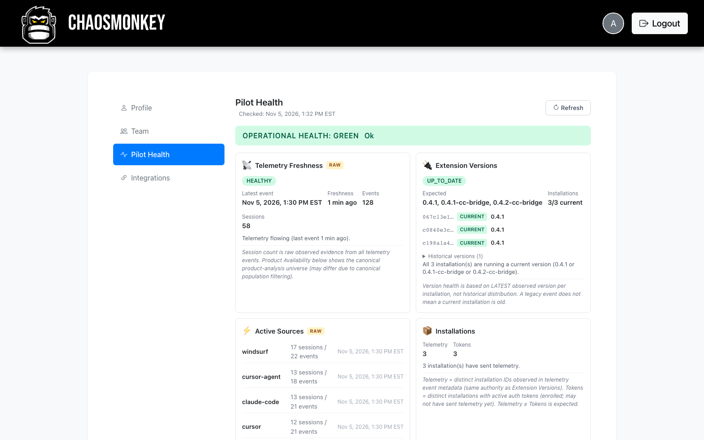
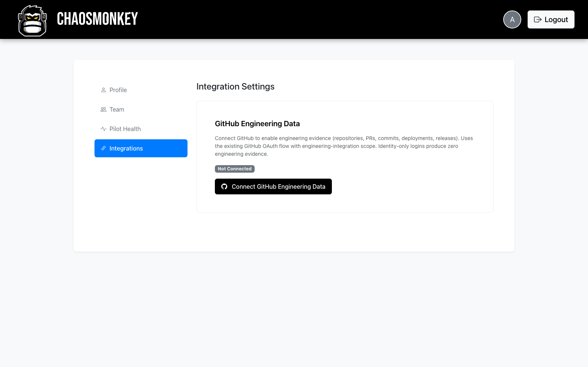
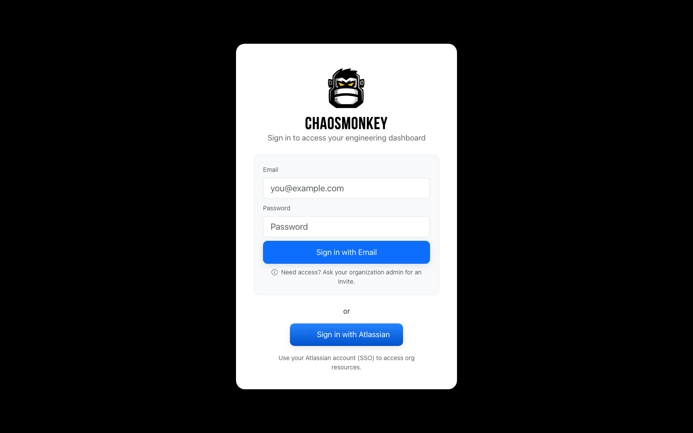

# Product gallery

Screenshots captured from a real `v0.1.0` all-in-one container. Every image
shows **synthetic demo data only** — generated by
[`tools/demo/telemetry-simulator.js`](../tools/demo/telemetry-simulator.js)
against three enrolled developer identities. No customer or production
telemetry appears anywhere in this gallery.

Where a feature depends on configuration that was intentionally left
unconfigured (GitHub integration, billing) or on evidence thresholds the demo
dataset does not yet meet (Performance Insights), the screenshot shows the
real unconfigured/evidence-gated state — we do not fake populated screens.

## Analytics

### AI Operational Intelligence

Per-workflow session analytics across every tracked tool — session runtime,
AI activity per session, adoption share, and instrumented coverage. Each
card is attributed to a distinct workflow (Cursor, Claude Code, Codex,
Devin, VS Code, Cursor Agent).

### Productivity by tool — cards

Per-workflow AI activity with historical averages, peaks, and an ops ticker
across all tracked workflows.

### Productivity by tool — time series

The same metrics as a time series, with cohort, developer, repository, and
workflow-comparison filters.

### Performance Insights — evidence gating

Performance Insights only fires on sufficient evidence. This install shows
the honest "collecting evidence" state: the engine reports how much data it
has, what thresholds apply, and what findings unlock next. Screenshots of
mature findings would require a dataset we did not fabricate.

## Team setup and enrollment

### Client setup

The "Pilot setup" panel lists every supported client with download and
setup actions — IDE extension (VS Code / Cursor / Devin), Claude Code,
Codex, and the Cursor Agents companion.

### Developer enrollments

Each developer gets a personal enrollment credential for the supported
clients — no dashboard login is required to send telemetry.

### Roster and dashboard users

Enrolled developers show connection status and installation counts; cohort
assignment and dashboard-user invites live on the same page.

## Operations

### Pilot Health

Operational health for the install: telemetry freshness, extension-version
distribution across installations, active sources, and token/installation
counts. This is the screen an administrator watches during rollout.

### GitHub integration — real unconfigured state

The GitHub Engineering Data card, shown unconfigured — the actual state of
a fresh install. Connecting GitHub enables optional delivery evidence
(repositories, PRs, commits, deployments); identity-only logins produce
zero engineering evidence.

## Access

### Sign in

Admin and member sign-in. Accounts are created by an organization
administrator — there is no self-serve signup.

